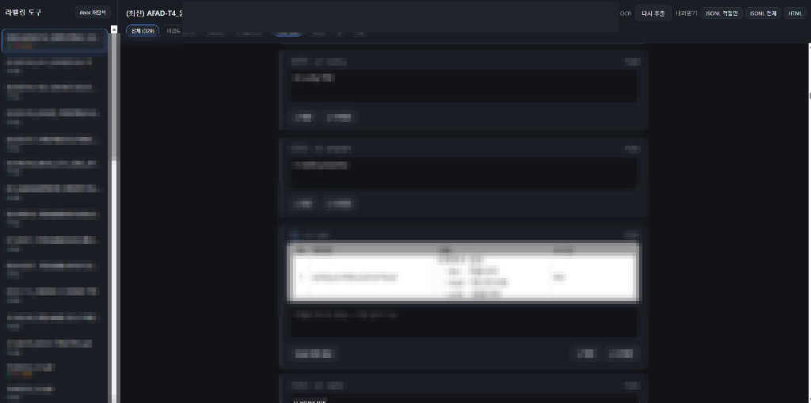

# AI Labeling Human

PDF에서 추출된 텍스트·표·그림을 사람이 확인하고 적합/부적합을 라벨링하는 웹 도구입니다.
이 폴더만으로 독립 실행할 수 있고, local-rag의 `tools/labeler`로 넣어도 됩니다.



## 실행 (이 폴더)

```bat
labeler.bat
```

```bash
chmod +x labeler.sh
./labeler.sh
```

첫 실행 시 `.venv` 생성·의존성 설치를 진행합니다. VL `llama-server`가 없으면
설치·모델 다운로드·기동 여부를 물어본 뒤, 동의한 경우에만 준비합니다.
거절해도 `http://localhost:8788`에서 라벨링 웹은 실행됩니다.

| 파일 | 역할 |
|------|------|
| `labeler.bat` / `labeler.sh` | 런처 |
| `ensure_vlm_server.py` | VL 서버 설치·기동 (`./llama-cpp`) |
| `config.py` | 경로·OCR·VLM 설정 |

local-rag 안에서는 `scripts/labeler.bat|sh`가 여기 런처를 호출합니다.

## 경로 설정

`config.py` 에서 PDF·작업 폴더·OCR·VLM 을 지정합니다.

```python
DOCS_DIR = Path(r"D:\my-pdfs")           # PDF 폴더
LABEL_DIR = Path(r"D:\labeling-out")     # DB·크롭 이미지 저장
HOST = "0.0.0.0"
PORT = 8788
# OCR_LANGS, OCR_GPU, VLM_HF_REPO, VLM_PORT, VLM_BASE_URL ... 도 같은 파일
```

`None` 이면 기본 경로:

- **독립 클론:** `./data/docs`, `./data/labeling`
- **local-rag 안:** `{local-rag}/data/docs`, `{local-rag}/data/labeling`

환경 변수로도 지정 가능합니다 (**환경 변수 > config.py 직접 설정 > 기본값**).

| 변수 | 설명 |
|------|------|
| `LABELER_DOCS_DIR` | PDF 폴더 |
| `LABELER_DATA_DIR` | 라벨 DB·이미지 루트 |
| `LABELER_HOST` | 바인드 주소 (기본 `0.0.0.0`) |
| `LABELER_PORT` | 포트 (기본 `8788`) |

예 (Windows):

```bat
set LABELER_DOCS_DIR=D:\pdfs
set LABELER_DATA_DIR=D:\labeling-out
labeler.bat
```

예 (Linux):

```bash
export LABELER_DOCS_DIR=/data/pdfs
export LABELER_DATA_DIR=/data/labeling
./labeler.sh
```

시작 로그에 `DOCS_DIR` / `LABEL_DIR` 이 출력되니 경로가 맞는지 확인하세요.

## 사용 흐름

1. `DOCS_DIR` 에 PDF를 넣고 좌측 [docs 재탐색]
2. PDF 선택 → [추출]
   - 텍스트: OpenDataLoader 구조 추출
   - 표·그림: 해당 영역을 PNG로 크롭 (pypdfium2)
   - 그림: EasyOCR(ko+en)로 글자 추출 (OCR 체크박스로 켜고 끔, 첫 실행 시 모델 다운로드)
3. 항목별로 확인
   - 텍스트 수정 가능 (오인식 교정) — 수정 시 자동 저장
   - [✓ 적합] / [✗ 부적합] 클릭 (다시 누르면 미검토로 복귀)
   - 필터: 미검토/적합/부적합 · 텍스트/표/그림
   - 그림·표 카드의 [VLM 설명 생성] — VL 모델이 이미지 자체를 이해해
     설명(다이어그램 연결 관계 등)을 만들어 텍스트란에 채웁니다 (아래 참고)
4. 내려받기 / 다시 올리기
   - **JSONL 적합만** — 학습·인제스트용. 표/그림 PNG를 `image_base64`로 포함 (`status: 1`만)
   - **JSONL 전체** — 일괄 라벨링용 (이미지는 넣지 않아 파일이 작음)
   - **HTML** — 사람 확인용 (크롭 이미지 base64 내장, 단일 파일)
   - **JSONL 올리기** — 수정한 JSONL을 다시 올려 적합여부를 반영 (아래 참고)

## 저장 위치

| 경로 | 내용 |
|------|------|
| `{LABEL_DIR}/labeler.sqlite3` | 문서·항목·라벨 |
| `{LABEL_DIR}/images/<doc_id>/` | 표·그림 크롭 PNG |
| `./llama-cpp/` | VL용 llama-server 바이너리 (사용자 확인 후 설치) |

## JSONL 일괄 라벨링

화면에서 항목을 하나씩 누르지 않고, JSONL을 내려받아 `status`만 고친 뒤 다시 올릴 수 있습니다.
UI 문구는 그대로 **적합 / 부적합 / 미검토**이고, 파일의 `status`만 숫자입니다.

1. 문서를 선택한 뒤 **JSONL 전체** 내려받기
2. 각 줄의 `status`를 수정 (`1`=적합, `0`=부적합, `null`=미검토)
3. 같은 문서가 선택된 상태에서 **JSONL 올리기**

반영 시 아래 **3개가 모두 일치**하는 줄만 적용하고, 하나라도 다르면 제외합니다.

| 키 | JSONL 필드 | 설명 |
|----|------------|------|
| 파일명 | `file_name` 또는 `rel_path` | 현재 연 문서와 같아야 함 |
| bbox | `bbox` | 항목 영역 좌표가 같아야 함 |
| idx | `id` (없으면 `order_idx`) | 같은 항목이어야 함 |

`text`를 같이 고치면 화면에 수정 텍스트로도 반영됩니다.
올리기 끝나면 `반영 N개 · 못 찾음 M개` 알림이 뜹니다.

### JSONL 형식 (1줄 = 1항목)

```json
{"id": 12, "order_idx": 3, "file_name": "a.pdf", "rel_path": "a.pdf", "page": 3,
 "bbox": [x0, y0, x1, y1], "element_type": "table", "kind": "table",
 "text": "최종 텍스트(수정본 우선)", "ocr_text": null,
 "image_path": "1/00012_table.png", "status": 1,
 "image_base64": "<PNG base64>", "image_mime": "image/png"}
```

텍스트만 있는 항목은 `image_base64`가 `null`입니다.
**JSONL 적합만**은 표/그림 크롭을 `image_base64`에 넣습니다. AI 학습·인제스트에 이 파일을 쓰면 됩니다.
**JSONL 전체**는 `status` 일괄 수정용이므로 이미지를 생략합니다 (용량). `?images=1`을 붙이면 전체에도 넣을 수 있습니다.

| `status` | 의미 |
|----------|------|
| `1` | 적합 |
| `0` | 부적합 |
| `null` | 미검토 |

예전 파일의 `"approved"` / `"rejected"` 문자열도 올리기는 됩니다. `image_base64`는 올려도 매칭에 쓰지 않고 무시합니다.

## VLM 설명 생성 (선택 기능)

OCR로 잡히지 않는 다이어그램을 VL 모델이 읽고 검색용 한국어 설명을 생성합니다.

**기동:** `labeler.bat` / `labeler.sh` → `ensure_vlm_server.py`  
`VLM_PORT`(기본 8090)를 확인하고, 없으면 사용자에게 확인한 뒤 `./llama-cpp`에
바이너리를 받고 `llama-server -hf <VLM_HF_REPO>`로 띄웁니다. 이미 떠 있으면
질문 없이 스킵하고, 거절하거나 실패해도 라벨러 웹은 그대로 시작합니다.

`-hf` 모델은 llama.cpp의 Hugging Face 캐시 형식으로 저장됩니다. labeler 런처
(`labeler.bat` / `labeler.sh`)는 이제 `LLAMA_CACHE`를
`local-rag/data/models`로 지정합니다. 따라서 이 경로에 이미 llama.cpp 형식으로
캐시된 호환 모델이 있으면 재사용하고, 없으면 사용자 확인 후 같은 경로에 받습니다.
환경 변수를 직접 지정하지 않고 `ensure_vlm_server.py`만 실행하면 기존 llama.cpp
기본 경로가 사용됩니다.
기존의 `data/models/*.gguf` 직접 파일은 Hugging Face 캐시 형식이 아니므로
`-hf` 모델로 자동 재사용되지 않습니다.

모델·포트는 `config.py`의 `VLM_*` / `OCR_*` 에 있습니다.

수동 실행 예:

```bat
llama-server -hf ggml-org/Qwen2.5-VL-3B-Instruct-GGUF --port 8090
```

서버가 뜬 뒤 그림/표 카드에서 [VLM 설명 생성]을 누르면 결과가 텍스트란에
채워지고 자동 저장됩니다.

환경 변수 (`config.py`보다 우선):

| 변수 | 기본값 | 설명 |
|------|--------|------|
| `VLM_HF_REPO` | `ggml-org/Qwen2.5-VL-3B-Instruct-GGUF` | `-hf` 모델 레포 |
| `VLM_PORT` | `8090` | VL 서버 포트 |
| `VLM_BASE_URL` | `http://localhost:8090/v1` | VL 서버 주소 |
| `VLM_MODEL` | (빈값) | 모델 alias (보통 불필요) |
| `VLM_MAX_TOKENS` | `1024` | 설명 최대 길이 |
| `VLM_TIMEOUT` | `300` | 응답 대기 초 |

CPU에서는 그림 1장에 수십 초~수 분 걸릴 수 있습니다.

"다시 추출"을 누르면 해당 문서의 기존 라벨이 삭제되니 주의하세요.
